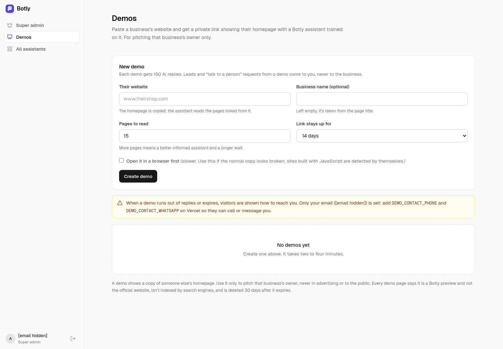

# Admin demo guide

**Who this is for:** platform super admins, meaning the addresses listed in `ADMIN_EMAILS`.
**What it covers:** the demo builder at **`/app/admin/demos`**, which makes a private pitch demo of Botly running on a copy of a prospect's homepage.

Code: `lib/demo/service.ts` (create, copy, train, expiry, sweep), `lib/demo/snapshot.ts` and `lib/demo/render.ts` (homepage copy), `app/app/admin/demos/*` (page and actions), `app/api/admin/demos/route.ts` (create), `app/demo/[slug]/route.ts` (the public demo page). Tables: `demo_sites` and `organizations.is_demo` (migrations `0009_demos.sql` and `0010_demos_upgrade.sql`).

---

## Make a demo

1. Sign in as a super admin and open **Admin → Demos** (`/app/admin/demos`). The page is admin-only.
2. Fill in the form:

| Field | Notes |
|---|---|
| **Their website** | Required. The homepage is copied, and the assistant reads the pages linked from it. |
| **Business name (optional)** | Taken from the page title when left empty. |
| **Pages to read** | 1–40, default 15. More pages give a better-informed assistant and a longer wait. |
| **Link stays up for** | 7, 14 or 30 days. The default comes from `DEMO_DEFAULT_DAYS` (14). |
| **Open it in a browser first** | Forces a headless-Chromium copy. Sites built with JavaScript are detected and rendered automatically; tick this only if the normal copy looks broken. |

3. Click **Create demo**. The demo appears in the list and moves through the statuses **Starting → Copying homepage → Training assistant → Ready**, usually in two to four minutes. The list refreshes while a build is running.
4. When it's **Ready**, use **Copy link** or **Open ↗**. The link is `https://botly.in/demo/<slug>`, where the slug is long and random. Send it only to the business owner.

## What a demo is, under the hood

- Each demo is a throwaway **organization with `is_demo = true`** on the `trial` plan, plus one **draft** bot.
- The bot is never set live and doesn't need an allowed-origins entry. The demo page loads the widget with the bot's **private test token**.
- Training uses the same crawler and onboarding pipeline customers get. In a demo, the pages it reads are approved automatically so the assistant can answer straight away.
- The prospect's homepage is stored in `demo_sites.html` and served from `/demo/<slug>` with `noindex`, a strict Content-Security-Policy and a notice that it's a Botly preview and not the official website.
- Leads from a demo go to **the admin who created it** (not the business), with **[DEMO]** in the email. No WhatsApp alerts are sent.
- Demo organizations are **left out of** the client list on `/app`, the admin client table, MRR and conversion, and trial emails. In the sidebar they show as "Demo · <name>".

## Reply caps

- Every demo gets **`DEMO_REPLY_LIMIT` AI replies (default 150)**. The limit is stored as the organization's `trial_reply_limit`, so the normal trial gate enforces it.
- The list shows **AI replies "used of limit"**, **Chats**, **Opened** (view count) and **First opened**.
- When the replies run out, the widget stops answering with AI and shows **your** contact details. Those come from `DEMO_CONTACT_PHONE`, `DEMO_CONTACT_WHATSAPP` and `DEMO_CONTACT_EMAIL`, falling back to `SUPPORT_PHONE`, then `SUPPORT_EMAIL`, then the first `ADMIN_EMAILS` address. The demo page warns you when only an email is set.
- The prospect never sees the business's real contact details from the demo bot.

## Expiry and clean-up

- The expiry date is the organization's `trial_ends_at`, so AI replies stop on that date. After it, `/demo/<slug>` shows "This preview has ended" (HTTP 410).
- **Daily sweep** (part of `/api/cron/retention`, 09:00 IST): marks demos past their date as **Expired** and frees the stored HTML. **30 days after expiry** it deletes the demo for good, together with its organization, bot, knowledge, conversations and leads.
- "They opened it" alert: the first time someone **who isn't an admin** opens the link, Botly emails `ALERT_EMAIL` (or the first admin) once. Admins viewing their own demo don't count.

## Row actions

| Action | When it's shown | What it does |
|---|---|---|
| **Conversations**, **Knowledge** | Always | Opens the demo bot's normal dashboard pages. |
| **Retry** | Failed | Runs the copy and training again. |
| **Refresh copy** | Ready | Copies the homepage again (for example, after the site changed). |
| **Retrain** | Ready | Reads the website again and rebuilds the knowledge. |
| **+14 days** | Not building | Moves the expiry 14 days on, counted from the later of today and the current expiry. A lapsed demo gets 14 days from today. The reply gate moves with it. |
| **Expire now** | Ready | Ends the demo immediately. |
| **Delete** | Not building | Deletes the demo and everything under it right away. |

## Environment variables

`DEMO_REPLY_LIMIT`, `DEMO_DEFAULT_DAYS`, `DEMO_CONTACT_PHONE`, `DEMO_CONTACT_WHATSAPP`, `DEMO_CONTACT_EMAIL`, `DEMO_RENDER` (`auto` by default, `off` disables headless rendering) and `DEMO_CHROME_PATH` (local development only: the path to a Chrome binary). On Vercel, rendering uses `@sparticuz/chromium`. See the [README environment table](../README.md#environment-variables).

## Troubleshooting

- **"Demos aren't set up yet"**: run `supabase/migrations/0009_demos.sql` (and `0010_demos_upgrade.sql`) in the Supabase SQL editor, then reload.
- **Failed**: the error appears under the row. Common causes are a site that blocks bots, a timeout, or a page with no readable text. Try **Retry** with **Open it in a browser first** ticked, or with fewer pages.
- **The copy looks broken**: create the demo again with **Open it in a browser first** ticked.
- **Replies feel generic**: check **Knowledge**. Add a note or FAQ by hand, then test on the demo link.

## Rules

A demo shows a copy of someone else's homepage. Use it **only to pitch that business's owner**, never in advertising or in public. Every demo page says it's a Botly preview, isn't indexed, and is deleted 30 days after it expires.

## Coming in open pull requests

[PR #5](https://github.com/vijayaprathap1/botly/pull/5) (`0013_demo_guards.sql`, which needs [PR #1](https://github.com/vijayaprathap1/botly/pull/1)'s `0011`) gives demo traffic its own slice of the shared AI budget, and counts knowledge drafts the builder refused to approve automatically. Neither is on `main` yet.

---

## Other super-admin tools (quick reference)

- **`/app/admin`**: MRR, active trials, trial-to-paid conversion, AI cost and estimated gross margin, plus a client table with filters. Per-organization actions: **extend the trial** (+7 days and +50 replies), **set the plan** to Starter or Growth (for clients billed by invoice), **suspend** with a reason, and **unsuspend**. It also lists the latest Razorpay billing events.
- **New client (done-for-you):** `/app/orgs/new`, then **Import** on the bot to crawl and draft. Review and approve drafts in **Knowledge**, run the checks, and invite the client from the bot's Overview → **Client access**.
- Admins see cost, model, quota and eval details on every bot. Owners never do.
