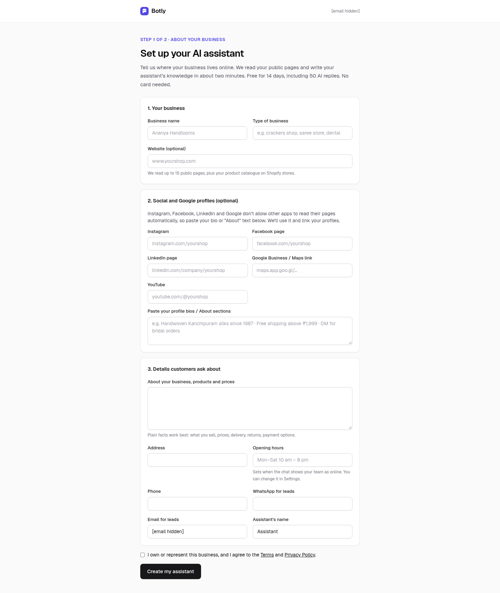
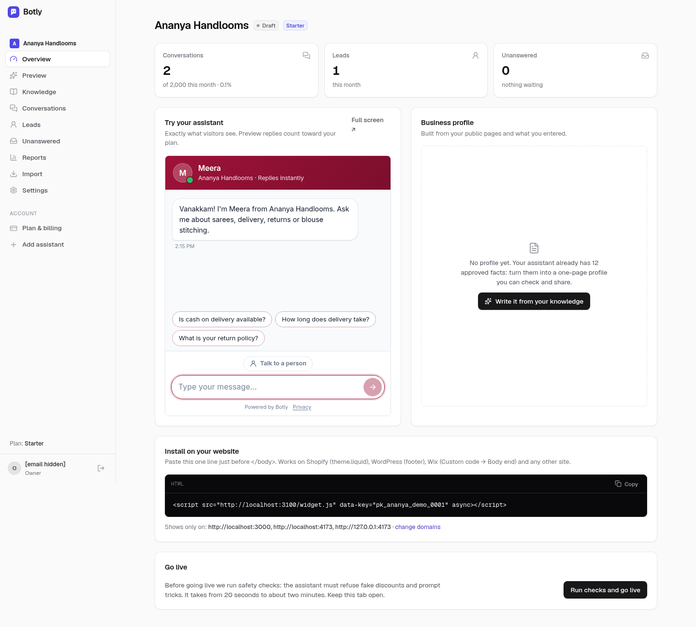
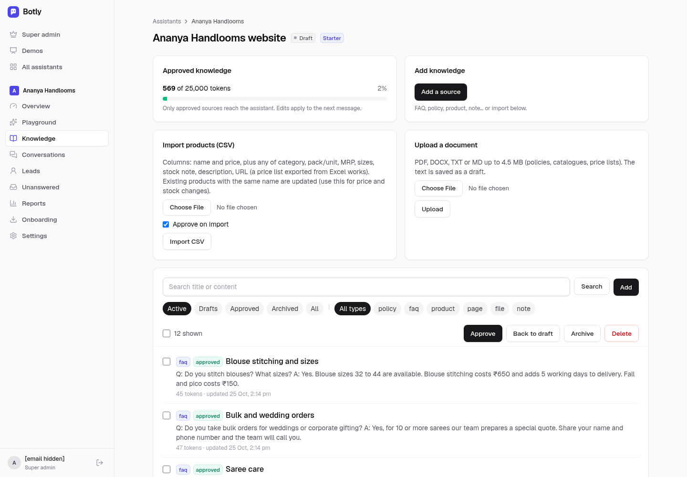
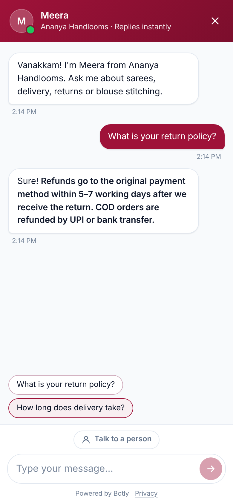
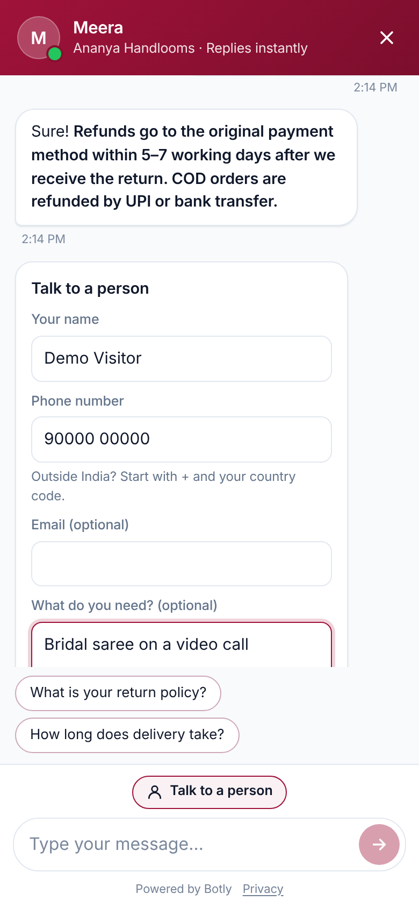
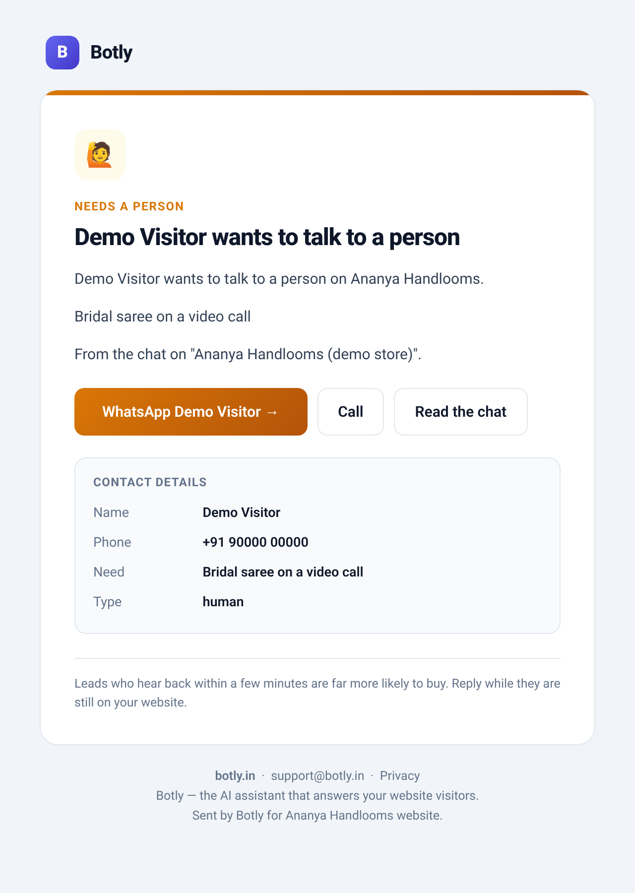
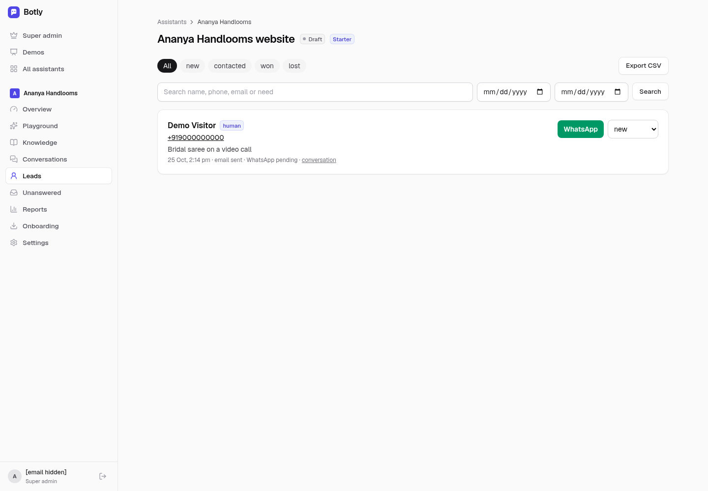
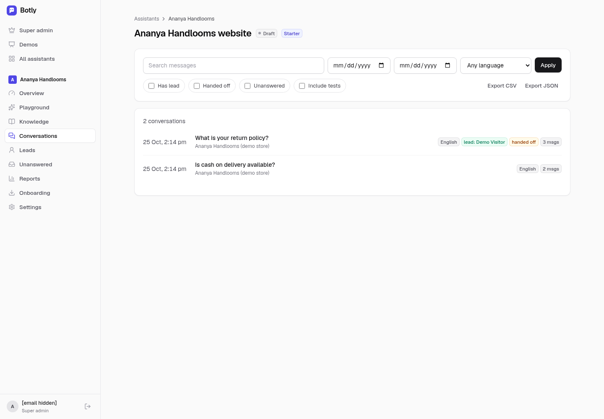
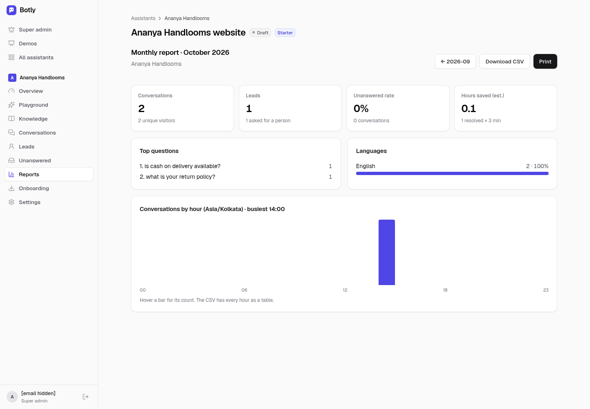
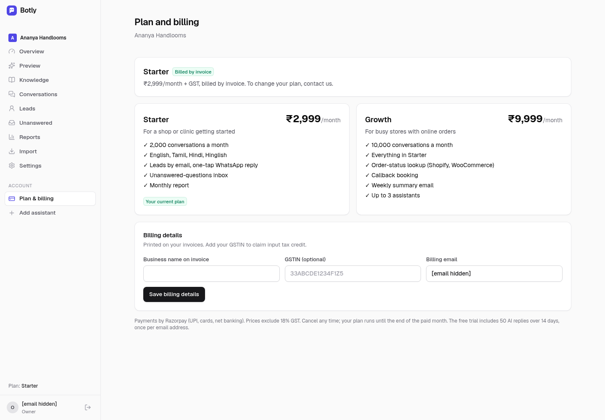

# Botly user guide (for business owners)

This guide follows a business owner from sign-up to a live assistant and then day-to-day use. Screens and wording match the app on `main`. Screenshots are from a demo business (Ananya Handlooms) with fake data.

Contents: [Sign up](#1-sign-up) · [Build your assistant](#2-build-your-assistant) · [Review and approve knowledge](#3-review-and-approve-knowledge) · [Try it and go live](#4-try-it-and-go-live) · [Install the widget](#5-install-the-widget) · [Leads](#6-leads) · [Handoff to a person](#7-handoff-to-a-person) · [Conversations and unanswered questions](#8-conversations-and-unanswered-questions) · [Reports](#9-reports) · [Settings](#10-settings) · [Trial and billing](#11-trial-and-billing) · [FAQ](#faq)

---

## 1. Sign up

1. Go to **https://botly.in** and click **Start free trial**, or open `/login` directly.
2. Sign in with your email. Botly sends a one-time sign-in link, so there's no password. If the site offers a Google button, you can use that too.
3. First-time users go to **/start** to set up their business.

You get **one free trial per email address**: 14 days and 50 AI replies. No card is needed.

## 2. Build your assistant



On **/start**, fill in what you can. The more you give, the better the answers.

| Field | Why it matters |
|---|---|
| Business name and type | Used in greetings and the business profile. |
| Website | Botly reads up to **15 public pages** of your site during the trial (40 on Starter, 100 on Growth). On a Shopify store it also reads your product list. |
| Social and Google profiles: Instagram, Facebook, LinkedIn and Google Business / Maps links, plus "Paste your profile bios / About sections" | **Botly does not read these sites.** Their terms don't allow automated reading. Paste your bio or About text here, and Botly saves it with the links as owner-provided knowledge. |
| About the business | Needed if you have no website: a few sentences about what you sell or do. |
| Address, opening hours, phone | Visitors ask these first. |
| WhatsApp number for leads | Puts the one-tap WhatsApp button in your lead emails, and is shown to visitors when the assistant hands over. |
| Email for leads | Where lead emails go. |
| Assistant name | What the chat calls itself. |

Click **Continue to my assistant**. Botly then:

1. Saves everything you typed as approved knowledge ("Details from the owner").
2. Reads your website (respecting `robots.txt`) and drafts **FAQs, a policy summary, a tone of voice and a one-page business profile**.
3. Runs the prompt-injection safety checks. If they all pass, the assistant goes **live**. If not, it stays in **Preview** and the Overview shows a **Run checks and go live** button.

This takes a minute or two. You can follow the progress on the assistant's **Overview** page.



## 3. Review and approve knowledge

The assistant answers **only from approved knowledge**. Anything in **Draft** or **Archived** is ignored.

Open **Knowledge** in the left menu.



- On a self-serve account, the FAQs, policy summary and profile Botly drafted during sign-up are **already approved**, so you can go live straight away. Read them once anyway and fix anything wrong. Raw website pages are kept as drafts for reference.
- Each source has a type (FAQ, policy, product, page, file or note) and a status. Select sources and use **Approve**, **Back to draft** or **Archive**, or edit the text directly. The filter tabs are Active, Drafts, Approved, Archived and All.
- **Add knowledge:** write a note or FAQ, upload a **product CSV**, or upload a **PDF, DOCX, TXT or MD** file. Uploaded files are saved as **drafts**. Check the extracted text, then approve it.
- **Import** (in the menu): re-read your website when it changes.
- The best fix for a wrong answer is to correct or add the knowledge. Then ask the question again in Preview.

> If you were set up by the Botly team (done-for-you), the team reviews and approves knowledge for you. In **Unanswered** you suggest answers and the team approves them.

## 4. Try it and go live

- **Overview → Try your assistant** shows the real widget. **Full screen ↗** opens your private test link (`/t/<token>`), which you can share with your team before launch. It isn't indexed. **Preview replies count toward your plan.**
- **Preview** in the menu is a test chat with quick buttons for English, Tamil, Hindi and Hinglish. You can type Tanglish (Tamil in English letters) too; the assistant replies in the language and script you write in.
- Going live needs every prompt-injection check to pass. **Run checks and go live** reruns them. **Pause (preview only)** takes the assistant off your site without removing the install code.

## 5. Install the widget

Copy the line from **Overview → Install on your website**:

```html
<script src="https://botly.in/widget.js" data-key="YOUR_BOT_PUBLIC_KEY" async></script>
```

Paste it just before `</body>`:

- **Any HTML site:** in the footer or layout template, so it loads on every page.
- **Shopify:** Online Store → Themes → ⋯ → Edit code → `layout/theme.liquid` → paste above `</body>` → Save.
- **WordPress:** the free WPCode plugin → Code Snippets → Header & Footer → **Footer** → Save. Or use `footer.php` in a child theme.
- **Wix:** Settings → Custom code (Advanced; needs a paid plan with a connected domain) → Add custom code → **Body – end**, **All pages**, **Load code once**.

Then add your domain under **Settings → Allowed domains**: one per line, for example `yourshop.in`, `www.yourshop.in`, `yourshop.myshopify.com` or `*.wixsite.com`. **On a domain that isn't listed, the widget doesn't appear.** That stops other sites from using your replies.



## 6. Leads

When a visitor wants to buy, order in bulk, asks for a callback or wants a person, the assistant asks for a **name and phone number**. Email and "what do you need?" are optional.



Each lead:

- Appears under **Leads**, with the conversation, need, language and status (**New → Contacted → Won / Lost**). You can filter by status and date, search, and export CSV.
- Is **emailed** to every address in **Settings → Lead emails**. The email has a big **WhatsApp {name}** button (opens a chat with the visitor on WhatsApp), a **Call** button and a **Read the chat** link.



- **WhatsApp alerts to you:** if the platform's WhatsApp Business sender is set up, Botly also sends a WhatsApp message to each number in **Settings → Lead WhatsApp numbers**. Until then those leads show **WhatsApp pending**. Email still goes out.



**Growth plan extras:** visitors can check an order's status (Shopify or WooCommerce, connected in **Settings → Order lookup**). The order number has to match the phone or email on the order. Visitors can also book a callback with a preferred date and time slot, which arrives as a lead.

## 7. Handoff to a person

The assistant hands over when the visitor asks for a person, is unhappy, or needs something only your team can do. The visitor can also tap **Talk to a person** at any time.

- If the visitor hasn't given contact details yet, the widget shows the short contact form.
- The lead is marked as a handoff, and you get the same email (and WhatsApp alert, if set up) with a two-line summary in English.
- The assistant is told your business hours and whether the team is open right now, so it can set expectations when you're closed. Set your hours in **Settings → Hours, domains and notifications**.
- If the assistant can't answer at all (trial or monthly limit reached, assistant paused, AI error), the widget shows your **fallback phone, WhatsApp and email** instead.

## 8. Conversations and unanswered questions

- **Conversations:** every chat with language, page, lead and handoff flags. Search, filter and export CSV or JSON.
- **Unanswered:** questions the assistant couldn't answer, grouped when similar, with how often they were asked. On a self-serve account, write the answer once and it's added to your approved knowledge. On a done-for-you account, you suggest the answer and the Botly team approves it.



## 9. Reports

**Reports** shows one month at a time: conversations, leads, the unanswered rate, estimated staff hours saved (from the minutes-per-conversation setting), top questions, languages, and conversations by hour of day. You can **download a CSV** or open a **print view** to save it as a PDF.



Growth accounts also get a summary email every Monday at about 9:00 AM IST.

## 10. Settings

- **Look and feel:** business name, assistant name, greeting, an optional nudge after 8 seconds, tone of voice, up to 4 suggested questions, colour, avatar, position (left or right) and light or dark theme. "Powered by Botly" can be hidden on Growth.
- **Hours, domains and notifications:** business hours, allowed domains, lead emails, lead WhatsApp numbers, and the fallback phone, WhatsApp and email.
- **Privacy notice URL**, and how many months to keep conversations and leads.
- **Visitor data deletion:** delete one visitor's data by phone number or visitor id. You have to type DELETE to confirm.
- **Make a new test link** if the private link leaked. The old one stops working immediately.
- Model, plan and quota are managed by the Botly team.

## 11. Trial and billing

**Trial:** 14 days and 50 AI replies, whichever runs out first. Preview replies count too. Botly emails you a welcome, a "few replies left" notice at 80%, a "trial ends in 2 days" notice and a "trial has ended" notice. **When the trial ends, the widget stays on your site but shows your contact details instead of AI answers.** Upgrade to switch the AI back on.

**Plans** (prices exclude 18% GST):

| | Starter | Growth |
|---|---|---|
| Price | ₹2,999 / month | ₹9,999 / month |
| Conversations per month | 2,000 | 10,000 |
| Assistants | 1 | up to 3 |
| Website pages read | 40 | 100 |
| Order status lookup (Shopify, WooCommerce) | — | ✓ |
| Callback booking | — | ✓ |
| Weekly summary email | — | ✓ |
| Hide "Powered by Botly" | — | ✓ |



**To pay:** open **Plan & billing** in the menu and click **Choose Starter** or **Choose Growth**. Razorpay Checkout opens (UPI, cards, net banking). It's a monthly subscription that renews automatically. Add your **billing name and GSTIN** under Billing details for GST invoices. The screenshot shows a done-for-you account that is billed by invoice instead.

- At **80% of your monthly conversations**, you get an email once. At 100%, the widget shows your contact details until the next month or an upgrade.
- **Cancel plan** stops renewal. Your plan stays active until the end of the paid month.
- A failed renewal shows as "Stopped: payment failed" until it's paid.
- Refunds follow the [refund policy](https://botly.in/refund-policy).

## FAQ

**Which languages does it speak?** English, Tamil, Hindi, Hinglish and Tanglish. It replies in the language and script the visitor used (Tamil script for Tamil, Roman letters for Hinglish or Tanglish). Reply quality depends on the AI model. A native-speaker check of Hindi replies is still on the [roadmap](../ROADMAP.md).

**Will it make things up?** It's instructed to answer only from approved knowledge, and otherwise to say it doesn't know and offer a person. Those questions go to **Unanswered**, so you can fill the gaps.

**Does it read my Instagram or Google profile?** No. Paste the text you want it to know into **/start** or **Knowledge**.

**How do I remove it from my site?** Delete the script line, or click **Pause (preview only)** on the Overview.

**Who do I contact?** support@botly.in, or the phone and WhatsApp number on https://botly.in/contact.
